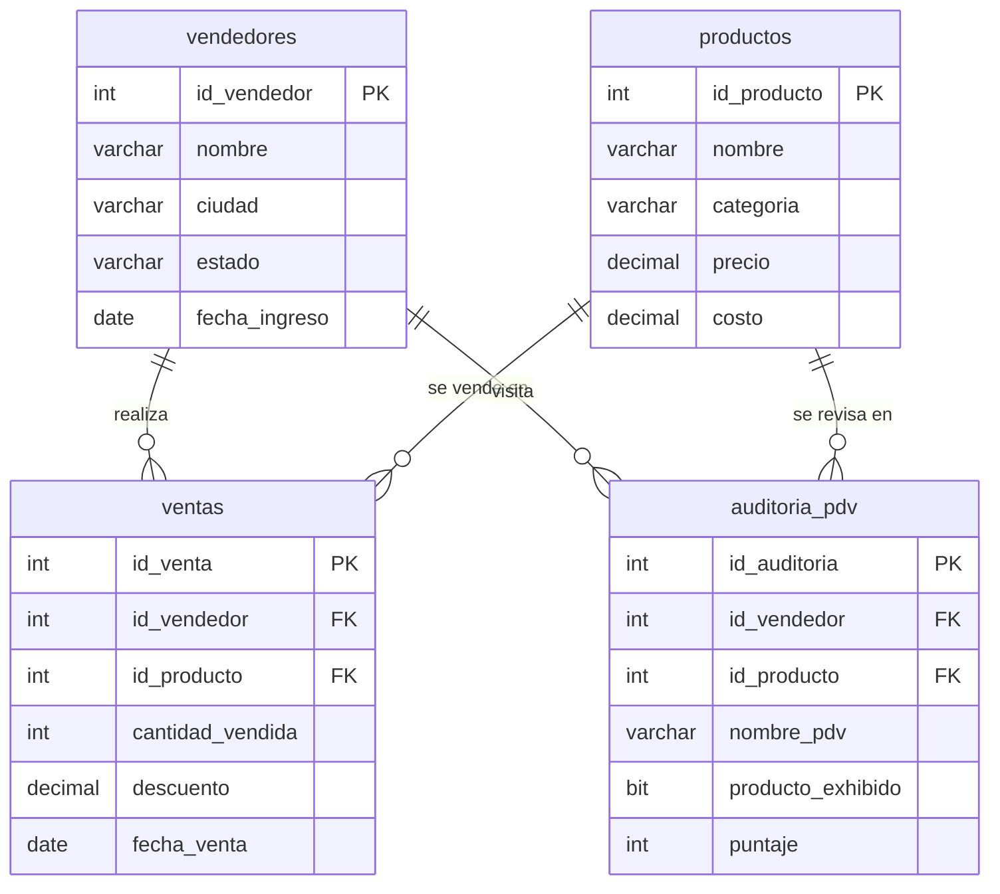

# Análisis de Trade Marketing con SQL Server

Proyecto de análisis de datos en SQL Server que responde preguntas de negocio sobre **ventas, rentabilidad y cumplimiento en puntos de venta** de una empresa de consumo masivo.

> **Datos simulados.** Toda la información de este proyecto (vendedores, productos, ventas y auditorías) es ficticia y fue creada con fines de práctica. Los datos están escritos como `INSERT` fijos, por lo que cualquier persona que ejecute los scripts obtiene exactamente los mismos resultados que se documentan aquí.

## Problema de negocio

Un equipo de Trade Marketing necesita saber qué vende, qué deja ganancia, cómo rinden sus vendedores y si los productos se están exhibiendo bien en las tiendas. Este proyecto responde esas preguntas con consultas SQL, de las más sencillas (`JOIN`, `GROUP BY`) a las más avanzadas (funciones de ventana y `CTE`).

## Modelo de datos

La base `trade_marketing` tiene 4 tablas relacionadas:

| Tabla | Qué guarda | Filas |
|---|---|---|
| `vendedores` | Las personas que venden y visitan los puntos de venta (ciudad, estado, fecha de ingreso) | 24 |
| `productos` | Catálogo con categoría, precio y costo | 30 |
| `ventas` | Cada venta: vendedor, producto, cantidad, medio de pago, descuento (%) y fecha | 5.000 |
| `auditoria_pdv` | Cada visita a un punto de venta: exhibición, precio correcto, material publicitario y puntaje (1 a 10) | 1.500 |



## Estructura del repositorio

```
sql-trade-marketing/
├── README.md
├── 01_crear_tablas.sql        -- crea la base de datos y las 4 tablas
├── 02_insertar_datos.sql      -- carga los datos simulados
└── 03_analisis/               -- una consulta por cada pregunta de negocio
    ├── 01_ventas_brutas_y_netas.sql
    └── 02_ventas_por_categoria.sql
```

## Cómo reproducirlo

1. Instalar **SQL Server** (edición Developer, gratuita) y **SQL Server Management Studio (SSMS)**.
2. En SSMS, abrir y ejecutar `01_crear_tablas.sql`.
3. Abrir y ejecutar `02_insertar_datos.sql` **una sola vez**. Al final muestra el conteo de filas de cada tabla: 24, 30, 5.000 y 1.500. Si se ejecuta de nuevo con datos ya cargados, el script se detiene y avisa; para empezar de cero se vuelve a correr el 01.
4. Ejecutar las consultas de la carpeta `03_analisis` en el orden de su numeración.

## Preguntas de negocio y hallazgos

| # | Pregunta | Técnicas | Estado |
|---|---|---|---|
| 1 | ¿Cuánto vendimos y cuántas ventas hubo? | `JOIN`, `SUM`, `COUNT`, `CAST` | Terminada |
| 2 | ¿Qué categoría deja más ingresos y cuál más margen? | `GROUP BY`, `ORDER BY` | Terminada |
| 3 | ¿Cuáles son los 5 productos con mayor margen? | `TOP`, `ORDER BY` | En curso |
| 4 | ¿Quiénes son los mejores vendedores de cada ciudad? | `RANK`, `PARTITION BY` | En curso |
| 5 | ¿Cómo evolucionan las ventas mes a mes y cuánto crecen? | `CTE`, `LAG` | En curso |
| 6 | ¿Qué ciudad tiene mejor cumplimiento en las auditorías? | `AVG`, `CASE` | En curso |
| 7 | ¿Las ciudades que cumplen más en tienda también venden más? | Cruce de ventas y auditorías | En curso |

### 1. Ventas totales

- Hubo **5.000 ventas** entre noviembre de 2025 y octubre de 2026.
- Las **ventas brutas** (precio × cantidad) suman **$329.044.700 COP**.
- Las **ventas netas** (con el descuento aplicado, lo que realmente se cobró) suman **$318.110.760 COP**.
- Los descuentos representan **$10.933.940 COP**, el **3,32%** de las ventas brutas.

*Archivo: `03_analisis/01_ventas_brutas_y_netas.sql`*

### 2. Ventas y margen por categoría

Se usan ventas netas porque reflejan lo que realmente se cobró. La utilidad se calcula como `(precio con descuento − costo) × cantidad`.

| Categoría | Ventas netas | Utilidad | Margen |
|---|---|---|---|
| Despensa | $85.160.065 | $20.219.165 | 23,7% |
| Bebidas | $56.826.270 | $17.667.670 | 31,1% |

- **Despensa** es la categoría que más ingresa y la que más utilidad total deja.
- **Bebidas** es la más rentable por cada peso vendido: 31,1% frente a 23,7%.
- Conclusión: vender más no siempre significa ganar más por venta. Bebidas es donde conviene reforzar exhibición y promociones.

*Archivo: `03_analisis/02_ventas_por_categoria.sql`*

## Herramientas

SQL Server · SQL Server Management Studio (SSMS) · Git y GitHub (GitHub Desktop)

## Proceso

Trabajé con un modelo de cuatro tablas relacionadas y escribí en SQL Server las consultas del análisis, de menor a mayor complejidad, para responder cada pregunta de negocio. Validé cada resultado contra los datos cargados (por ejemplo, comprobando que las ventas netas fueran menores que las brutas y que el conteo de filas coincidiera con lo esperado) y corregí errores de fórmula y de formato durante el desarrollo. Los datos son simulados y están escritos como `INSERT` fijos.

## Mejoras futuras

- Separar los puntos de venta (PDV) en su propia tabla, en lugar de guardar su nombre dentro de `auditoria_pdv`.
- Agregar una tabla de fechas para facilitar el análisis por mes y trimestre.
- Conectar la base a Power BI para construir un tablero con estos resultados.

## Autor

**Diego Pérez** · Ingeniero de Sistemas · Análisis de datos
[LinkedIn](www.linkedin.com/in/diego-perez480) · [Correo](devcode480@gmail.com)
